# Ahmad Cloud-Native Enterprise Platform

> **Production-oriented DevSecOps reference implementation on AWS** — Terraform, multi-AZ VPC design, Amazon ECS on AWS Fargate, Amazon ECR, Application Load Balancer, Amazon RDS for PostgreSQL, Amazon SQS with a Dead-Letter Queue, AWS KMS, Secrets Manager, AWS WAFv2, GitHub Actions evidence, Prometheus/Grafana telemetry, and Kubernetes workload manifests.

<!-- Optional: replace these with repository-specific links once this README is in its final GitHub repository. -->


---

## 1. Executive Summary

This repository demonstrates how to design, provision, inspect, and progressively harden a cloud-native application platform using infrastructure as code and managed AWS services. The implementation is organized around a three-tier network boundary:

1. **Edge / ingress tier** — a Regional AWS WAFv2 Web ACL associated with a public Application Load Balancer (ALB).
2. **Application tier** — an Amazon ECS service running AWS Fargate tasks in private application subnets, with no public IP assignment.
3. **Data tier** — an Amazon RDS for PostgreSQL instance placed in isolated data subnets and protected by a security group that accepts PostgreSQL traffic only from the ECS task security group.

The platform also provisions an encrypted SQS queue and DLQ, a customer-managed KMS key, a Secrets Manager secret, centralized ECS logging, a CloudWatch alarm-to-SNS-to-Lambda notification path, and a local Prometheus/Grafana telemetry stack. Kubernetes manifests provide a second workload expression for the API, including non-root execution, resource requests/limits, probes, and an HPA with explicit scale-down stabilization.

### Scope and implementation accuracy

This README distinguishes **deployed infrastructure** from **application integrations and production-hardening recommendations**. The supplied source files verify the AWS resources and Kubernetes manifests described below, but they do not yet demonstrate every end-to-end runtime flow:

- The FastAPI `POST /users` endpoint currently returns a simulated “queued successfully” response. The supplied application has no SQS SDK call, queue publisher, worker, or RDS persistence implementation.
- The RDS instance is encrypted and placed in the isolated data subnet group, but the supplied Terraform does not enable `multi_az`; a subnet group spanning two AZs does not itself create an RDS Multi-AZ deployment.
- The Kubernetes assets are Deployment, Service, and HPA manifests. The supplied Terraform does not provision an EKS control plane, node capacity, cluster add-ons, or an EKS identity/network foundation.
- The supplied ECS service has a fixed desired count of two. An ECS Service Auto Scaling target/policy is not present in the provided Terraform.
- The ALB listener shown in Terraform is HTTP on port 80. HTTPS/ACM termination is a required production-hardening item, not a currently evidenced control.
- A successful GitHub Actions run is included as screenshot evidence, but the workflow YAML was not present in the supplied source archive. The CI/CD section therefore describes the intended pipeline contract and identifies what should be linked from the repository.

The project should be presented as a **production-oriented portfolio lab/reference architecture**, not as a security-audited or regulated production system. The hardening backlog in [Section 12](#12-production-readiness-review--prioritized-hardening-backlog) is deliberately explicit so reviewers can distinguish what is implemented from what remains to be engineered.

---

## 2. Platform at a Glance

| Domain | Implemented in the supplied artifacts | Engineering significance |
|---|---|---|
| Infrastructure as Code | Terraform `>= 1.5.0`, AWS provider `~> 5.0`, modular root configuration | Repeatable infrastructure provisioning and reviewable change plans |
| Remote state | S3 bucket, versioning, AES-256 server-side encryption, public-access block, DynamoDB lock table; backend migration evidence | Shared state persistence, recovery history, and concurrency control |
| Network | VPC `10.0.0.0/16`, six subnets across two AZs, IGW, two NAT Gateways, S3 Gateway Endpoint | Public ingress separated from private compute and isolated database placement |
| Container registry | Private ECR repository, KMS encryption, scan-on-push | Centralized image distribution and vulnerability visibility |
| Runtime | ECS cluster, Fargate task definition, ECS service, ALB, IP target group | Managed container scheduling without customer-managed EC2 hosts |
| Data | RDS PostgreSQL 15, isolated DB subnet group, storage encryption, SG-scoped ingress | Private database placement and encrypted storage |
| Messaging | SQS standard queue, long polling, redrive policy, DLQ, SQS-managed encryption | Durable queue primitive and failed-message isolation |
| Key management | Customer-managed KMS key with automatic rotation enabled | Customer-controlled encryption key lifecycle |
| Secrets | Secrets Manager secret encrypted with the KMS key | Central secret storage primitive; application retrieval still needs wiring |
| Edge protection | Regional WAFv2 ACL, rate-based rule, AWS SQLi managed rule group | Selected Layer-7 threat and request-rate controls |
| Observability | ECS Container Insights, CloudWatch Logs, ALB 5xx alarm, SNS, Lambda-to-Telegram; local Prometheus/Grafana | Cloud alarm path plus application metrics visualization |
| Kubernetes | Deployment, LoadBalancer Service, HPA (`min=3`, `max=10`) | Workload portability and declarative autoscaling policy |
| Delivery evidence | Docker build evidence and successful GitHub Actions screenshot | Build/deployment workflow evidence; workflow source should be committed and linked |

---

## 3. High-Level Architecture

The diagram below is intentionally explicit about the difference between **provisioned infrastructure paths** and **not-yet-wired application paths**. Dashed connections represent network permissions or provisioned services that are not invoked by the supplied FastAPI code.

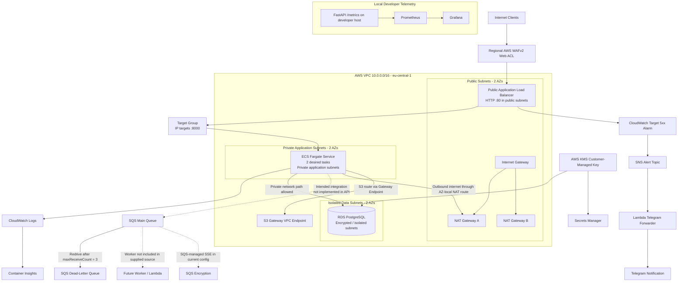

### 3.1 Request path

1. A client reaches the public ALB through the Regional WAFv2 Web ACL.
2. The ALB forwards traffic to an IP target group on TCP/8000.
3. The ECS service runs Fargate tasks in private application subnets with `assign_public_ip = false`.
4. The ECS task security group allows inbound TCP/8000 only from the ALB security group.
5. The ALB target group evaluates the configured `/docs` health-check path and removes unhealthy targets from routing.

**Transport caveat:** the listener in the supplied Terraform is HTTP/80. Add an ACM-backed HTTPS/443 listener, redirect HTTP to HTTPS, and use an approved TLS security policy before describing the edge path as encrypted in transit.

### 3.2 Private network path

- Public subnets route their default route to the Internet Gateway.
- Each private application subnet is associated with a per-AZ private route table whose default route targets the NAT Gateway in that AZ.
- The S3 Gateway Endpoint is associated with the public and private route tables declared in the module.
- The isolated data subnets are used by the RDS DB subnet group and are not associated with the application-tier NAT route tables in the supplied code. They therefore retain the VPC-local route only through the main route table unless additional routes are added.
- The database security group accepts TCP/5432 from the ECS task security group, not from a broad CIDR range.

### 3.3 Event-driven path: provisioned primitive vs. target state

The SQS main queue and DLQ are provisioned with a redrive policy. However, the current FastAPI implementation does not call `SendMessage`, and no consumer is included. The intended production flow is:

```text
API request
   │ validate + authorize
   ▼
SQS SendMessage (idempotency key / correlation ID)
   │
   ▼
Worker (ECS service or Lambda event source mapping)
   │ bounded retries + idempotent processing
   ▼
RDS transaction
   │
   └── after max receives ──► DLQ + alert + replay runbook
```

A queue is a buffer, not a guarantee that a request will eventually be persisted. Delivery semantics, consumer idempotency, visibility timeout, retry behavior, DLQ operations, and database recovery behavior must all be implemented and tested before claiming end-to-end durable registration.

---

## 4. Network Architecture and Address Plan

**Region:** `eu-central-1`  
**VPC CIDR:** `10.0.0.0/16`  
**Availability Zones:** `eu-central-1a`, `eu-central-1b`

| Tier | AZ | CIDR | Intended resources | Internet route |
|---|---|---:|---|---|
| Public | `eu-central-1a` | `10.0.1.0/24` | ALB node, NAT Gateway A | `0.0.0.0/0 → IGW` |
| Public | `eu-central-1b` | `10.0.2.0/24` | ALB node, NAT Gateway B | `0.0.0.0/0 → IGW` |
| Private application | `eu-central-1a` | `10.0.11.0/24` | ECS Fargate task ENIs | `0.0.0.0/0 → NAT Gateway A` |
| Private application | `eu-central-1b` | `10.0.12.0/24` | ECS Fargate task ENIs | `0.0.0.0/0 → NAT Gateway B` |
| Isolated data | `eu-central-1a` | `10.0.21.0/24` | RDS subnet group member | No explicit IGW/NAT default route |
| Isolated data | `eu-central-1b` | `10.0.22.0/24` | RDS subnet group member | No explicit IGW/NAT default route |

### Network controls

| Control | Current configuration | Operational intent |
|---|---|---|
| Internet Gateway | Attached to VPC | Public ingress/egress for public subnets |
| NAT Gateways | Two, each in a public subnet, each with an EIP | AZ-local outbound path for private application workloads |
| Public route table | Default route to IGW | Internet-reachable edge subnet routing |
| Private route tables | One per AZ, each defaulting to its matching NAT Gateway | Avoids a single shared NAT egress dependency across both app subnets |
| S3 Gateway Endpoint | Associated to public and private route tables | Private S3 data-plane access without NAT traversal for S3 traffic |
| ALB security group | Inbound TCP/80 from `0.0.0.0/0` | Public HTTP listener; replace/extend with HTTPS policy |
| ECS task security group | Inbound TCP/8000 from ALB SG only | Prevents direct Internet ingress to tasks |
| RDS security group | Inbound TCP/5432 from ECS task SG only | Restricts database ingress to the application security boundary |
| Network ACLs | No custom NACL resources are defined in supplied Terraform | AWS default NACL behavior remains; add custom stateless ACLs only for a documented control requirement |

### Networking considerations

- **Availability Zone alignment:** two NAT Gateways avoid a single NAT Gateway becoming the shared egress dependency for both application AZs. NAT Gateways have hourly and data-processing costs; VPC endpoints should be evaluated for frequently used AWS services.
- **VPC endpoints:** the current code defines only the S3 Gateway Endpoint. For private Fargate tasks, evaluate interface endpoints for ECR API, ECR Docker, CloudWatch Logs, Secrets Manager, Systems Manager, and STS where applicable. Endpoint policies should be scoped to the required repositories, logs, secrets, and accounts.
- **Egress control:** the ECS and RDS security groups currently have broad outbound rules. Security groups are stateful, but least-privilege egress should still be designed for the application’s actual dependencies.
- **Subnet mapping:** public subnets enable automatic public IPv4 assignment on launch. Fargate tasks explicitly disable public IP assignment. Keep public subnet placement limited to internet-facing infrastructure such as the ALB and NAT Gateways.

---

## 5. Delivery Phases: Phase 0 Through Phase 9

The phases below follow the project’s dependency order and describe the controls, rationale, implementation evidence, and remaining production work.

### Phase 0 — Engineering foundation, Terraform governance, and remote state

**Objective:** establish a controlled IaC workflow before creating application infrastructure.

**Implemented controls**

- Terraform version constraint: `>= 1.5.0`.
- AWS provider major version constraint: `~> 5.0`.
- Region configured as `eu-central-1`.
- A state bucket with versioning, AES-256 server-side encryption, and S3 Block Public Access.
- A DynamoDB table with a string partition key named `LockID` for Terraform state locking.
- The production root configuration includes a backend module and a commented S3 backend block, consistent with a bootstrap-then-migrate workflow.

**Why this matters**

Terraform state is a sensitive control-plane asset. It maps configuration to real resources and can contain credentials or other sensitive values. Remote state, access control, version history, and locking reduce the risk of local-state loss and concurrent-writer corruption.

**Recommended operating sequence**

1. Bootstrap state infrastructure from a separate bootstrap configuration or an explicitly controlled initial local state.
2. Verify the bucket, versioning, encryption, public-access block, and access policy.
3. Configure the remote backend and migrate existing state with `terraform init -migrate-state`.
4. Restrict state access to the deployment role and a small administrative group.
5. Back up and test state recovery procedures before relying on it for production changes.

**Hardening delta**

- The supplied S3 bucket uses `force_destroy = true`; this is inappropriate for a protected state vault. Set it to `false`, apply `prevent_destroy` where appropriate, and use a dedicated bootstrap state.
- Add a bucket policy that denies non-TLS requests, enforce the intended encryption policy, scope object access to the exact state prefix, and consider CloudTrail S3 data events and stronger recovery controls.
- The source uses DynamoDB-based locking. Current HashiCorp S3 backend documentation marks DynamoDB locking as deprecated and supports S3-native lockfiles using `use_lockfile = true`. Plan the migration based on the Terraform version selected for the repository. See [HashiCorp S3 backend documentation](https://developer.hashicorp.com/terraform/language/backend/s3).
- Do not commit `terraform.tfstate`, `.tfplan` files, `.terraform/`, credentials, or unredacted provider output.

**Evidence:** S3 backend migration, state bucket, lock table, and Terraform apply screenshots in [Section 13](#13-verification-evidence--23-screenshots).

### Phase 1 — Multi-AZ, multi-tier network foundation

**Objective:** create explicit trust boundaries and predictable routing for public ingress, private compute, and isolated data services.

**Implemented controls**

- One VPC with a `/16` CIDR.
- Six `/24` subnets split into public, private application, and isolated data tiers across two AZs.
- An Internet Gateway and two NAT Gateways with Elastic IPs.
- A public route table and AZ-specific private route tables.
- An S3 Gateway VPC Endpoint.
- Security-group chaining from ALB to ECS tasks and ECS tasks to RDS.

**Engineering rationale**

The ALB is the public entry point. The compute tier receives traffic only from the ALB security group. The data tier has no public IP and receives database traffic only from the ECS task security group. The network is designed to make unintended east-west access harder and to make the ingress path auditable.

**Hardening delta**

- Add interface VPC endpoints where they reduce NAT dependency and tighten AWS service egress.
- Define explicit VPC Flow Logs destinations, retention, encryption, and alarm/search workflows.
- Add custom NACLs only if they contribute a measurable, documented stateless control; do not mistake the default NACL for a bespoke network policy.
- Consider IPv6 deliberately rather than inheriting dual-stack assumptions.
- Validate subnet capacity against Fargate task ENIs, ALB scaling, endpoints, and future workloads.

**Evidence:** VPC Resource Map screenshot.

### Phase 2 — Container build, registry, and image supply-chain controls

**Objective:** produce a repeatable application image and store it in a private registry with encryption and vulnerability visibility.

**Implemented controls**

- FastAPI application with `/`, `/users`, `/docs`, and Prometheus `/metrics` instrumentation.
- Docker image runs as a non-root user (`UID 10001`).
- ECR repository is private, uses KMS encryption, and enables scan-on-push.
- The evidence set includes local image/build output, registry push activity, and before/after ECR vulnerability views.

**Hardening delta**

- The supplied Dockerfile is based on `python:3.9-slim`. Python 3.9 reached end of life on **31 October 2025** and no longer receives security updates. Upgrade the application image and Lambda runtime to a supported Python release, then rebuild and rescan. See the [Python version support schedule](https://devguide.python.org/versions/).
- The ECR repository currently uses mutable tags and `force_delete = true`. Prefer immutable release tags or digest pinning, lifecycle policies, and deletion protection through the release process.
- Add a multi-stage build, pinned base image digest, dependency hashes, `.dockerignore`, and a minimal runtime layer.
- Add a Docker `HEALTHCHECK` or rely on a documented orchestrator health endpoint; do not leave health semantics implicit.
- Generate an SBOM, scan dependencies and the final image, sign/promote the image, and deploy by digest rather than `:latest`.
- Keep build credentials out of Docker layers, build arguments, repository files, and logs.

**Suggested supply-chain gates**

| Gate | Example control | Release decision |
|---|---|---|
| Source hygiene | Secret scan, lint, code review | Fail on leaked credentials or policy violations |
| Dependency integrity | Lockfile + hash verification | Fail on unapproved or vulnerable dependencies |
| Image inspection | ECR scan / Trivy or equivalent | Fail or require exception for critical/high findings according to policy |
| Artifact provenance | SBOM + signed image digest | Promote only traceable artifacts |
| Deployment identity | GitHub Actions OIDC role assumption | No long-lived AWS access keys in GitHub secrets |

**Evidence:** local image, Docker build, AWS registry connection, ECR provisioning, and ECR scan comparison screenshots.

### Phase 3 — ECS Fargate runtime and ALB ingress

**Objective:** run the API as a managed, replaceable workload without maintaining EC2 instances.

**Implemented controls**

- ECS cluster with Container Insights enabled.
- Fargate task definition using `awsvpc` networking, `256` CPU units and `512 MiB` memory.
- ECS service desired count of two tasks in private application subnets with public IP assignment disabled.
- ALB in the public subnets, IP target group on TCP/8000, and ECS service registration.
- ECS task ingress is restricted to the ALB security group.
- ECS execution role is attached to `AmazonECSTaskExecutionRolePolicy` for the platform tasks such as image pulls and log delivery.
- CloudWatch log group retention is configured to 30 days.

**Control-plane distinction**

The supplied task definition configures an **execution role**, but does not define a separate **task role** for application code. These roles have different responsibilities: the execution role supports ECS/Fargate operations such as image pulls and log delivery; a task role grants AWS API permissions to code inside the container. See [Amazon ECS IAM roles](https://docs.aws.amazon.com/AmazonECS/latest/developerguide/ecs-iam-role-overview.html).

**Hardening delta**

- Add an HTTPS/443 listener with an ACM certificate and redirect HTTP/80 to HTTPS. AWS documents the certificate and listener requirements in [Create an HTTPS listener for an ALB](https://docs.aws.amazon.com/elasticloadbalancing/latest/application/create-https-listener.html).
- Replace `/docs` as the target-group health check with a lightweight, purpose-built readiness endpoint. Keep API documentation disabled or access-controlled in production.
- Add ECS deployment circuit-breaker/rollback behavior and define minimum/maximum healthy percentages deliberately.
- Add ECS Service Auto Scaling with CPU/memory or ALB request-per-target metrics, explicit min/max capacity, cooldowns, and scaling alarms. A desired count of two alone is not autoscaling.
- Define a task role with narrowly scoped SQS, Secrets Manager, KMS, and other application permissions only after the application integrations exist.
- Consider Fargate ephemeral storage, task CPU/memory sizing, graceful shutdown, container stop timeout, and log redaction as explicit workload requirements.

**Evidence:** ECS service/task view, working API endpoint, and target-group health/chaos screenshots.

### Phase 4 — Data tier, encryption, secrets, and asynchronous messaging primitives

**Objective:** provision a private data service and queueing primitives with encryption boundaries and a failed-message path.

#### RDS PostgreSQL

**Implemented**

- PostgreSQL 15 DB instance.
- `db.t3.micro` class in the supplied configuration.
- 20 GiB allocated storage with a 100 GiB maximum autoscaling setting.
- DB subnet group uses the two isolated data subnets.
- Storage encryption uses the customer-managed KMS key.
- Security group accepts TCP/5432 only from the ECS task security group.

**Not currently implemented / production gap**

- `multi_az` is not enabled in the supplied DB instance resource; therefore the configuration does not prove an RDS Multi-AZ failover deployment. Multi-AZ is an explicit RDS deployment option that provisions a standby in another AZ; a two-AZ subnet group only makes placement possible. See [RDS Multi-AZ DB instance deployments](https://docs.aws.amazon.com/AmazonRDS/latest/UserGuide/Concepts.MultiAZSingleStandby.html).
- `skip_final_snapshot = true` removes a critical deletion safety net. Set it to `false`, define a final snapshot identifier strategy, and protect production databases from accidental destroy.
- The DB password is hard-coded in Terraform source, while the Secrets Manager secret is populated separately with a different username. The application is not shown retrieving the secret. These values must be reconciled and moved to a managed secret flow before public release or production use.
- Add an explicit backup retention period, deletion protection, maintenance window, parameter group, Performance Insights/Enhanced Monitoring policy, and tested restore procedure according to the workload's RPO/RTO.

#### SQS and DLQ

| Queue property | Main queue | Dead-letter queue |
|---|---:|---:|
| Type | Standard | Standard |
| Retention | 4 days | 14 days |
| Long polling | 20 seconds | Not specified |
| Maximum receives before redrive | 3 | N/A |
| Encryption | SQS-managed server-side encryption | SQS-managed server-side encryption |

The redrive policy moves messages to the DLQ after the configured receive threshold. The main queue and DLQ are infrastructure primitives; application publishing, consumption, idempotency, visibility-timeout tuning, poison-message handling, and DLQ replay tooling are not present in the supplied FastAPI source.

**Recommended event-processing contract**

- Validate and authorize the request before enqueueing.
- Use a stable business idempotency key and correlation ID.
- Return `202 Accepted` only after SQS confirms message acceptance.
- Make the worker idempotent because at-least-once delivery can result in repeat processing.
- Configure visibility timeout relative to the maximum processing duration and bounded retry policy.
- Alarm on `ApproximateAgeOfOldestMessage`, queue depth, and DLQ visible-message count.
- Define a controlled DLQ redrive process with audit logging and duplicate-safety checks.

#### KMS and Secrets Manager

**Implemented**

- Customer-managed KMS key with automatic key rotation enabled and a seven-day deletion window.
- Alias `alias/ahmad-enterprise-key`.
- Secrets Manager secret encrypted with the KMS key.

**Hardening delta**

- A seven-day key deletion window and a zero-day secret recovery window are aggressive for production. Use an approved key/secret retirement window and documented recovery process.
- Avoid embedding secret values in `.tf` files. Terraform `sensitive = true` redacts selected CLI output; it does not remove values from Terraform state or prevent values from being committed in source.
- Prefer RDS-managed master credentials or a secret injected through the ECS task definition, with tightly scoped `secretsmanager:GetSecretValue` and `kms:Decrypt` permissions on the task execution role as appropriate. The application task role is separate and should be granted only application-level AWS API access.
- Align secret username/password with the actual RDS principal and validate rotation behavior before enabling automatic rotation.

**Evidence:** SQS queue, customer-managed key, and Secrets Manager screenshots.

### Phase 5 — Observability, telemetry, and alert routing

**Objective:** turn runtime behavior into actionable signals and deliver alerts to an operator.

**AWS-native path implemented**

- ECS Container Insights is enabled on the ECS cluster.
- ECS application logs are delivered to a CloudWatch Log Group with 30-day retention.
- A CloudWatch metric alarm watches `HTTPCode_Target_5XX_Count` for the ALB target group, with a threshold greater than three over a 60-second period and one evaluation period.
- The alarm publishes to an SNS topic.
- SNS invokes a Lambda function that forwards the alarm message to Telegram.

**Local application telemetry implemented**

- FastAPI uses `prometheus-fastapi-instrumentator` and exposes `/metrics`.
- Prometheus scrapes the API at `host.docker.internal:8000` every five seconds.
- Grafana visualizes the collected metrics through a local Docker Compose monitoring network.

**Important boundary:** the supplied Prometheus target is a developer-host endpoint, not an ECS private service discovery target. The Prometheus/Grafana stack shown in the provided Compose file is therefore a local development/validation stack; it should not be represented as an AWS-hosted highly available monitoring service. The CloudWatch/SNS/Lambda alert path is separate.

**Hardening delta**

- Upgrade the Lambda runtime from Python 3.9 to a supported runtime.
- Store the Telegram token in Secrets Manager or a protected deployment secret path; do not place it in version control or plaintext environment configuration.
- Add timeout, retry, error handling, structured logs, and a Lambda failure destination/DLQ or equivalent operational strategy.
- Add alarms for queue age/depth, DLQ depth, ECS running-vs-desired task count, task restarts, target response time, RDS CPU/storage/connections, and failed deployments.
- Add correlation IDs to API logs and worker messages; define a consistent structured logging schema.
- Protect Grafana with non-default credentials, restrict exposed ports, and persist dashboards/configuration as code.

**Evidence:** Prometheus target health, Grafana telemetry dashboard, and Telegram alarm screenshots.

### Phase 6 — Edge security and WAFv2 controls

**Objective:** apply managed Layer-7 inspection and request-rate controls before traffic reaches the application.

**Implemented controls**

- Regional AWS WAFv2 Web ACL associated with the ALB.
- Rate-based rule blocks a source IP when it exceeds the configured threshold of 1,000 requests in the WAF evaluation window.
- AWS managed SQL injection rule group is enabled.
- WAF metrics and sampled requests are enabled for visibility.

**Scope clarification**

The supplied Web ACL includes rate limiting and the AWS SQLi managed rule group. It does not include the full AWS Managed Rules Core Rule Set (CRS) or every rule family implied by broad “OWASP Top 10” protection language. AWS documents the [baseline managed rule groups](https://docs.aws.amazon.com/waf/latest/developerguide/aws-managed-rule-groups-baseline.html); select and tune them against application traffic rather than assuming one group covers every vulnerability class.

**Hardening delta**

- Evaluate AWS Managed Rules Common Rule Set, Known Bad Inputs, Amazon IP Reputation List, Anonymous IP List, and Bot Control where the threat model and budget justify them.
- Start new managed rule groups in Count mode, inspect sampled requests and metrics, tune exclusions, then move to Block mode with change control.
- Treat WAF as one Layer-7 control, not a substitute for application authorization, secure coding, TLS, rate limiting at appropriate business keys, or DDoS planning.
- Enable HTTPS on the ALB and enforce secure headers and application-level request validation.
- Add WAF logging with redaction for sensitive fields and retention aligned to privacy requirements.

**Evidence:** WAF Web ACL and rule configuration screenshots.

### Phase 7 — CI/CD, policy gates, and deployment provenance

**Objective:** make changes reviewable, testable, attributable, and safely promotable.

The supplied evidence includes a successful GitHub Actions run and Docker build/push evidence. The actual `.github/workflows/*.yml` file was not included in the uploaded code archive; link the real workflow here once it is committed. Do not document a specific action version, scan tool, branch policy, or deploy strategy unless it is present in that workflow.

**Recommended pipeline contract**

| Stage | Checks | Failure behavior |
|---|---|---|
| Pull request | `terraform fmt -check`, `terraform validate`, app unit tests, YAML/manifests validation | Block merge on failure |
| IaC security | TFLint, Checkov/tfsec, policy-as-code, secret scan | Block on critical policy/secret findings; document exceptions |
| Application | Lint, type checks, tests, dependency audit | Block image build if required gates fail |
| Image | Build, scan, SBOM, signing/attestation | Promote only approved immutable digest |
| Infrastructure plan | Terraform plan artifact with reviewer approval | No unreviewed production apply |
| Deployment | Assume AWS role via GitHub OIDC; update ECS task definition by digest | No long-lived IAM user keys in repository secrets |
| Post-deploy | ALB target health, smoke test, error-rate check | Fail/rollback deployment if health criteria are not met |

**Recommended trust model**

Use GitHub OIDC federation to assume a narrowly scoped AWS IAM role. Restrict trust by repository, branch/environment, and workflow identity. Separate plan and apply permissions where feasible, require environment approvals for production, and retain plan, SBOM, image digest, and deployment metadata as artifacts.

**Evidence:** GitHub Actions successful run, Docker build pipeline, ECR push evidence.

### Phase 8 — Resilience validation and failure engineering

**Objective:** validate recovery behavior through controlled fault injection rather than relying on architecture diagrams alone.

The supplied evidence includes an ALB target-group / chaos-healing screenshot. The ECS service has a desired count of two and a health-checked ALB target group. This is useful evidence of target health behavior, but it does not by itself establish a complete disaster-recovery posture or a measured service-level objective.

**Recommended experiment matrix**

| Experiment | Fault injection | Expected behavior | Evidence to capture |
|---|---|---|---|
| Task replacement | Stop one ECS task | ECS service scheduler replaces the task; healthy target continues serving | Task event timeline, desired/running count, target health |
| Readiness failure | Make the application fail its readiness endpoint | ALB stops routing to the unhealthy target; replacement/recovery is observed | Target health reason, request success rate |
| AZ dependency | Simulate loss of one app subnet/AZ only in a safe test environment | Remaining capacity serves traffic; alarms identify reduced redundancy | AZ-level service/task distribution and synthetic requests |
| Queue backlog | Pause a real worker while publishing test messages | Oldest-message age and visible-message count rise; processing resumes after worker recovery | Queue metrics, worker logs, final business record count |
| Poison message | Deliver a deliberately invalid payload | Retries are bounded; message reaches DLQ; alarm fires | Receive count, DLQ event, replay audit |
| Database recovery | In a disposable environment, disrupt DB connectivity | API degrades safely; retry policy and recovery are observable | RDS events, application errors, recovery time |
| Deployment rollback | Deploy a failing image or failing health check in a test environment | Deployment circuit breaker/rollback restores last known good revision | ECS deployment events and health timeline |

**Measure, do not assume**

For each test, record the start time, fault, expected behavior, observed behavior, recovery time, user-visible impact, and follow-up issue. Define RTO/RPO from business requirements. Do not claim “zero downtime” or “no data loss” without test evidence and an explicitly bounded failure model.

### Phase 9 — Kubernetes workload translation and autoscaling policy

**Objective:** express the API workload declaratively in Kubernetes and compare orchestration primitives with ECS.

**Manifests included**

| Resource | Current manifest behavior |
|---|---|
| Deployment | Three initial replicas; selector labels the `enterprise-api` workload |
| Pod security context | `runAsNonRoot: true`, UID 10001, `fsGroup: 10001` |
| Container security context | `allowPrivilegeEscalation: false`; drops all Linux capabilities |
| Filesystem | `readOnlyRootFilesystem: false` (not fully hardened) |
| Resource requests | 100m CPU, 128Mi memory |
| Resource limits | 250m CPU, 256Mi memory |
| Probes | Liveness `/metrics`; readiness `/docs` |
| Service | `LoadBalancer`, with AWS NLB-related annotations and IP target mode |
| HPA | `autoscaling/v2`, CPU target 50%, minimum 3, maximum 10 replicas |
| Scale-down behavior | 300-second stabilization window; 10% policy per 60-second period |
| Scale-up behavior | Zero-second stabilization window; up to 100% per 15-second period |

The CPU HPA target is calculated relative to CPU requests, so defining requests is necessary. The Kubernetes control plane must also expose resource metrics (commonly via Metrics Server) for CPU-based autoscaling to function. See the [Kubernetes HPA documentation](https://kubernetes.io/docs/concepts/workloads/autoscaling/horizontal-pod-autoscale/).

**Important scope boundary:** these manifests do not create an EKS cluster. EKS control plane, managed node groups or Fargate profiles, VPC CNI, CoreDNS, kube-proxy, Metrics Server, AWS Load Balancer Controller (where required by the selected ingress design), IAM Roles for Service Accounts / EKS Pod Identity, cluster logging, and cluster security configuration are separate infrastructure and add-on concerns.

**Hardening delta**

- Replace the `<AWS_ACCOUNT_ID>` placeholder and `latest` with the approved immutable ECR digest.
- Use a dedicated namespace instead of `default` and define service accounts/identity bindings explicitly.
- Add PodDisruptionBudget, topology spread constraints or pod anti-affinity, startup probe, and graceful termination settings.
- Change `readOnlyRootFilesystem` to `true` after validating writable paths and mounting only required `emptyDir` volumes.
- Use dedicated `/health/live` and `/health/ready` endpoints; avoid coupling liveness to metrics or documentation routes.
- Add NetworkPolicies where the selected CNI enforces them, and define ingress/egress policy intentionally.
- Configure HPA behavior against load-test results; monitor replica saturation and node capacity, not only average CPU.
- Validate the Service annotations against the installed AWS Load Balancer Controller / EKS version and the intended NLB provisioning path.

---

## 6. Application Contract and Current Runtime Behavior

The supplied API is a deliberately small FastAPI validation service.

| Route | Current behavior | Production consideration |
|---|---|---|
| `GET /` | Returns a health-style welcome payload | Replace with dedicated liveness/readiness endpoints |
| `GET /users` | Returns two static sample users | Connect to a real data repository and enforce authorization |
| `POST /users` | Validates `name` and `email`, then returns a simulated queue-success message | Implement actual SQS publishing, idempotency, accepted-response semantics, and worker persistence |
| `GET /docs` | OpenAPI Swagger UI | Restrict or disable outside controlled development environments |
| `GET /metrics` | Prometheus instrumentation endpoint | Restrict access to trusted monitoring paths; avoid exposing sensitive labels |

The API currently does not demonstrate authentication, authorization, persistence, request rate controls at the application layer, or actual SQS integration. The deployed infrastructure provides network and platform primitives that can host these controls, but application-level guarantees require application code and tests.

---

## 7. Security Architecture and Threat-Control Mapping

| Threat / failure mode | Current mitigation | Remaining engineering action |
|---|---|---|
| Direct Internet access to containers | Fargate tasks have no public IP; task SG trusts ALB SG | Add HTTPS, tighten egress, validate subnet/route behavior continuously |
| Untrusted web requests | WAF rate-based rule and managed SQLi rule group | Add/tune baseline managed rules, logging, application validation, secure authz |
| Unauthorized database ingress | RDS SG accepts only ECS task SG on 5432 | Add application authn/authz, TLS to DB, credential rotation, DB audit strategy |
| Lost or exposed infrastructure state | S3 versioning/encryption/public-access block and lock table | Remove force-destroy, use modern locking, restrict state access, test recovery |
| Image vulnerabilities | ECR scan-on-push and scan evidence | Immutable digests, CI gating, SBOM, signing, patch SLAs |
| Container privilege escalation | Docker runs as UID 10001; Kubernetes disables privilege escalation and drops capabilities | Read-only filesystem, seccomp profile, AppArmor/SELinux where supported, runtime policy |
| Data at rest exposure | RDS KMS encryption; Secrets Manager KMS encryption; SQS-managed SSE | Verify all storage services, backups, logs, and state encryption; manage key policy/rotation |
| Message processing failure | SQS redrive policy and DLQ | Implement consumer, idempotency, visibility timeout, alarms, replay controls |
| Runtime outage | Two desired ECS tasks and ALB target health checks | ECS autoscaling, circuit breaker, AZ-failure validation, RDS Multi-AZ, SLOs |
| Secret disclosure | Secrets Manager resource exists | Remove literals from code/history/state; rotate credentials; inject secrets at runtime |
| Cloud alert delivery failure | CloudWatch → SNS → Lambda → Telegram | Lambda retry/failure destination, secret retrieval, alert delivery SLO, secondary channel |

### IAM separation model

A hardened implementation should keep these identities distinct:

- **GitHub Actions deploy role:** federation via OIDC; only the exact infrastructure and deployment operations required by the workflow.
- **Terraform execution role:** scoped provisioning permissions, ideally separated by environment and reviewed through plan/apply approvals.
- **ECS task execution role:** ECR image pull, CloudWatch log delivery, and Secrets Manager/SSM retrieval permissions required by the task definition.
- **ECS task role:** application runtime permissions such as `sqs:SendMessage` or `sqs:ReceiveMessage` only after those calls exist in the code.
- **Lambda execution role:** CloudWatch logging plus only the resources it actually reads/writes; do not grant broad administrative access.

Avoid combining deployment, execution, and application permissions into one broad IAM role.

---

## 8. Repository Layout

The uploaded source archive contained flattened file exports rather than the complete directory hierarchy. The following is a **recommended logical layout** matching the Terraform module references and supplied artifacts; adjust names to the actual checked-in paths before publishing.

```text
.
├── README.md
├── environments/
│   └── production/
│       ├── main.tf                 # prod_main.tf content
│       ├── providers.tf
│       ├── variables.tf
│       └── outputs.tf
├── modules/
│   ├── backend/                    # S3 state bucket + lock table
│   ├── vpc/                        # VPC, subnets, IGW, NAT, routes, endpoint
│   ├── ecs/                        # ECR, ECS, ALB, target group, security groups
│   ├── sqs/                        # main queue + DLQ
│   ├── security/                   # KMS + Secrets Manager
│   ├── rds/                        # PostgreSQL + DB subnet group + SG
│   ├── waf/                        # Regional WAFv2 ACL + ALB association
│   └── observability/              # CloudWatch alarm, SNS, Telegram Lambda
├── app/
│   ├── main.py
│   ├── requirements.txt
│   └── Dockerfile
├── monitoring/
│   ├── docker-compose.yml
│   └── prometheus.yml
├── kubernetes/
│   ├── deployment.yaml
│   ├── service.yaml
│   └── hpa.yaml
├── .github/
│   └── workflows/                  # commit the actual CI/CD workflow here
└── docs/
    └── screenshots/                # the 23 evidence images referenced below
```

---

## 9. Reproduction and Validation Workflow

> **Do not run the deployment commands against a live account until the hard-coded credentials, state-bucket deletion behavior, RDS deletion settings, and HTTP-only listener have been corrected.** The commands below are a repeatable workflow template. Adjust the working directory to the actual repository layout.

### 9.1 Prerequisites

- An AWS account and a dedicated deployment identity with least-privilege permissions.
- AWS CLI configured through an approved profile or federation mechanism.
- Terraform version compatible with the repository constraints.
- Docker Engine / Docker Desktop.
- Python runtime supported by the project after upgrading the supplied Python 3.9 base image.
- `kubectl` and an existing Kubernetes cluster only for applying the Kubernetes manifests.

### 9.2 Terraform checks

```bash
terraform fmt -recursive
terraform -chdir=environments/production init
terraform -chdir=environments/production validate
terraform -chdir=environments/production plan -out=tfplan
```

Review the plan for public exposure, IAM policy scope, state changes, data deletion, key replacement, and unexpected resource recreation. Apply only through an approved process:

```bash
terraform -chdir=environments/production apply tfplan
```

### 9.3 Application and image validation

```bash
cd app
python -m venv .venv
source .venv/bin/activate
pip install -r requirements.txt
uvicorn main:app --host 127.0.0.1 --port 8000
```

In another terminal:

```bash
curl -i http://127.0.0.1:8000/
curl -i http://127.0.0.1:8000/users
curl -i http://127.0.0.1:8000/metrics
```

Build and inspect the container image after updating the base image and Dockerfile hardening:

```bash
docker build --pull -t ahmad-enterprise-api:dev .
docker run --rm -p 8000:8000 ahmad-enterprise-api:dev
```

### 9.4 AWS runtime checks

Use the AWS CLI to verify actual deployed state instead of relying only on a successful Terraform apply:

```bash
aws ecs describe-services \
  --cluster ahmad-enterprise-cluster \
  --services ahmad-enterprise-service

aws ecs list-tasks \
  --cluster ahmad-enterprise-cluster \
  --service-name ahmad-enterprise-service

aws elbv2 describe-target-health \
  --target-group-arn <TARGET_GROUP_ARN>

aws sqs get-queue-attributes \
  --queue-url <MAIN_QUEUE_URL> \
  --attribute-names All
```

### 9.5 Kubernetes validation

Replace the account ID and image reference with the immutable ECR digest, confirm the cluster has Metrics Server and the AWS load-balancer integration needed by the selected Service annotations, then apply:

```bash
kubectl apply -f kubernetes/deployment.yaml
kubectl apply -f kubernetes/service.yaml
kubectl apply -f kubernetes/hpa.yaml

kubectl get deployments,pods,services,hpa
kubectl describe hpa ahmad-enterprise-api-hpa
kubectl top pods
```

An HPA object can exist while remaining unable to scale if the resource metrics API is unavailable. Confirm metrics are populated before treating autoscaling as verified.

---

## 10. Operational Runbooks

### ECS task becomes unhealthy

1. Inspect ALB target health reason codes and ECS service events.
2. Correlate the target's task ID with the CloudWatch log stream.
3. Verify application startup, dependency reachability, CPU/memory pressure, and health endpoint behavior.
4. Confirm the ECS service returns to desired capacity and the replacement target passes health checks.
5. Record recovery time and whether users experienced failed requests.

### Queue backlog or DLQ growth

1. Inspect visible/in-flight message counts and `ApproximateAgeOfOldestMessage`.
2. Check worker capacity, error rate, visibility timeout, and downstream database status.
3. Stop uncontrolled retries if the consumer is producing poison-message loops.
4. Inspect DLQ messages in a controlled, access-audited workflow.
5. Fix the consumer and replay only after confirming idempotency and business-level duplicate handling.

### Alert delivery failure

1. Check the CloudWatch alarm state and recent metric datapoints.
2. Verify SNS publication and Lambda invocation metrics/logs.
3. Confirm the notification secret is retrievable by the Lambda execution role.
4. Check Telegram API response and outbound connectivity.
5. Use a secondary notification channel for production-critical alerts.

### Terraform state lock contention

1. Confirm whether another legitimate plan/apply is in progress.
2. Identify the lock owner and operation before taking action.
3. Never delete a lock because a command appears slow.
4. Use force-unlock only when the owning operation is known to be terminated and the lock ID has been verified.

---

## 11. Cost and Lifecycle Considerations

This is a learning/portfolio architecture, not a free-by-default deployment. The largest recurring cost drivers can include:

- Two NAT Gateways and their data processing.
- Public ALB capacity and data processing.
- Two or more Fargate tasks and associated vCPU/memory time.
- RDS instance hours, allocated storage, backups, and cross-AZ traffic where applicable.
- CloudWatch ingestion, retention, metrics, and Container Insights.
- Interface VPC endpoints if added.
- ECR image storage and data transfer.
- WAF request processing and any optional managed rule groups.

Before provisioning, estimate costs in the AWS Pricing Calculator for the selected Region, instance sizes, traffic profile, log volume, and experiment duration. Tag every resource by project, environment, owner, and cost center. Destroy ephemeral lab resources when no longer needed, but protect remote Terraform state, KMS keys, and any data that must be retained.

**Teardown warning:** the supplied code sets `force_destroy = true` on the state bucket and ECR repository, and `skip_final_snapshot = true` on RDS. These settings can make destructive teardown easier but are not appropriate defaults for a protected production environment. Separate the state backend from disposable application infrastructure and take/verify database backups before removal.

---

## 12. Production Readiness Review & Prioritized Hardening Backlog

The following items are intentionally listed as engineering work, not as completed controls.

| Priority | Finding from supplied source | Required remediation before production |
|---|---|---|
| **P0** | Literal database credentials are present in Terraform source; a Grafana admin password is hard-coded in the Compose file | Rotate exposed credentials; remove literals from source and Git history; move secrets to a secure runtime injection path; review Terraform state and artifacts |
| **P0** | Dockerfile and Lambda use Python 3.9, which reached EOL on 2025-10-31 | Upgrade to a currently supported Python runtime, rebuild, test, rescan, and redeploy |
| **P0** | ALB listener is HTTP/80 only | Add ACM-backed HTTPS/443 and HTTP-to-HTTPS redirect; validate TLS policy |
| **P0** | RDS password and Secrets Manager payload do not describe the same DB username; secret is not injected into the task | Establish one authoritative credential source, reconcile DB login, grant narrowly scoped retrieval, and test rotation |
| **P1** | RDS does not set `multi_az`; final snapshot is skipped | Enable the required HA mode, set deletion protection/final snapshots, define backup retention and restore tests |
| **P1** | FastAPI response claims an SQS queue action but no SQS publisher or worker exists | Implement real message publishing/consumption, idempotency, bounded retries, DLQ monitoring, and end-to-end tests |
| **P1** | ECS service desired count is fixed at two | Add ECS Service Auto Scaling and deployment circuit-breaker/rollback controls |
| **P1** | ECR image tag is mutable (`latest`) and repository allows force delete | Use immutable tags/digests, lifecycle policy, artifact promotion and deletion safeguards |
| **P1** | State bucket has `force_destroy = true`; DynamoDB locking is used | Protect the bucket; migrate to the supported S3 lockfile model for the chosen Terraform version; isolate backend lifecycle |
| **P1** | ECS task has execution role but no task role; secrets and SQS are not wired | Separate execution/task roles and grant only required actions/resources |
| **P1** | WAF includes SQLi and rate limiting, but not the broader managed baseline rule set | Evaluate baseline managed rule groups, logging, false-positive tuning, and threat-model coverage |
| **P1** | Kubernetes Deployment uses `latest`, default namespace, writable root filesystem, and no PDB/topology constraints | Pin image digest; add namespace, PDB, topology controls, read-only FS, startup probe and identity/network policy |
| **P2** | Prometheus/Grafana are local Compose services; target is host-local | For centralized operations, deploy a secured remote telemetry backend or integrate with AWS-native observability |
| **P2** | Lambda notification has minimal error handling and no explicit failure destination | Add retries, timeout, idempotent delivery, failure destination/DLQ, secret management and secondary channel |
| **P2** | Egress rules are broad and only S3 Gateway Endpoint exists | Add required interface endpoints and restrict egress by dependency |
| **P2** | Terraform state bucket lacks explicit TLS-only bucket policy and `force_destroy` protection | Add policy guardrails, access logging/data events, retention and recovery runbook |

### Release gate

A release should not be described as production-ready until the P0 items are closed, the P1 controls are either implemented or formally accepted as risks, the application-to-SQS-to-RDS flow is tested end to end, and resilience tests produce documented recovery measurements.

---

## 13. Verification Evidence — 23 Screenshots

Place the 23 supplied screenshots under `docs/screenshots/` using the exact filenames below. The gallery is grouped by the engineering phase it supports. These images are evidence of observed console or terminal state; they do not replace source code, test output, or repeatable validation.

### 13.1 Terraform foundation and state management

| Evidence | What it demonstrates |
|---|---|
| `terraform_apply.png` | Terraform apply/output evidence |
| `terraform-s3-backend-migration.png` | Migration from local state to remote S3 backend |
| `aws-s3-state-bucket.png` | S3 state bucket configuration |
| `aws-dynamodb-state-lock.png` | DynamoDB state-lock table |

<details>
<summary>Show Phase 0 screenshots (4)</summary>

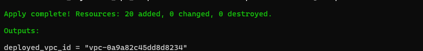

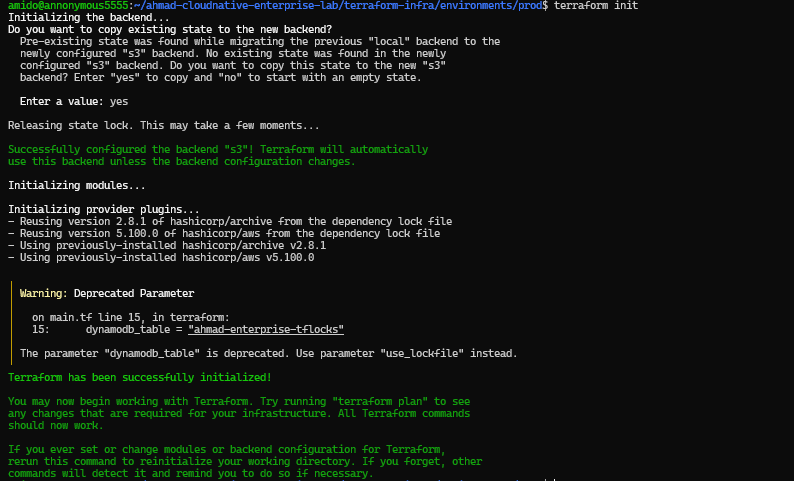

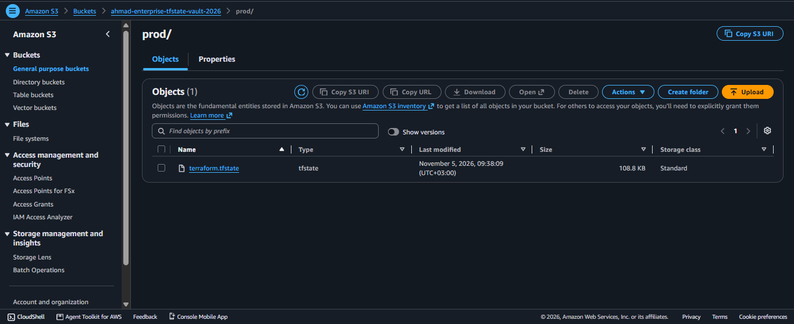

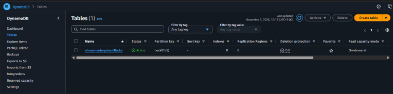

</details>

### 13.2 Network foundation

| Evidence | What it demonstrates |
|---|---|
| `aws-vpc-resource-map.png` | VPC topology and subnet distribution |

<details>
<summary>Show Phase 1 screenshot (1)</summary>

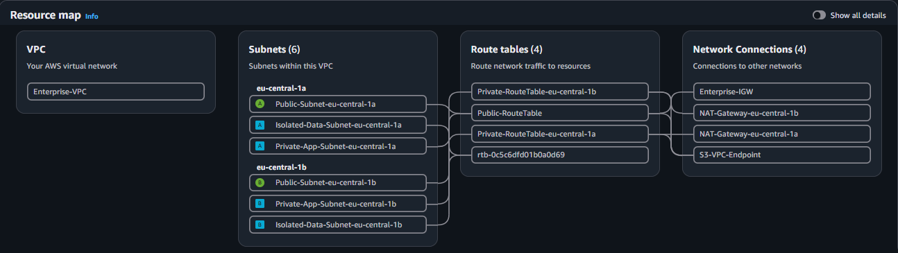

</details>

### 13.3 Container build and registry supply chain

| Evidence | What it demonstrates |
|---|---|
| `docker-images-local.png` | Locally built application image |
| `docker-build-pipeline.png` | Docker build output / pipeline step |
| `docker_connect_AWS.png` | Docker-to-AWS registry authentication/connection evidence |
| `ecr_terraform_apply.png` | Terraform provisioning of ECR |
| `aws-ecr-vulnerabilities-before.png` | ECR scan findings before remediation |
| `aws-ecr-vulnerabilities-after.png` | ECR scan findings after remediation/build update |

<details>
<summary>Show Phase 2 screenshots (6)</summary>

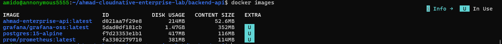

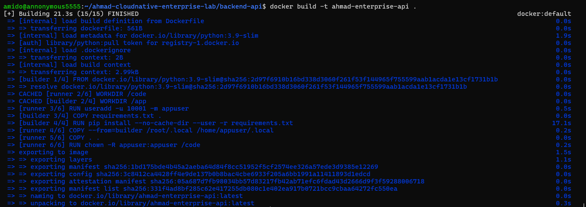

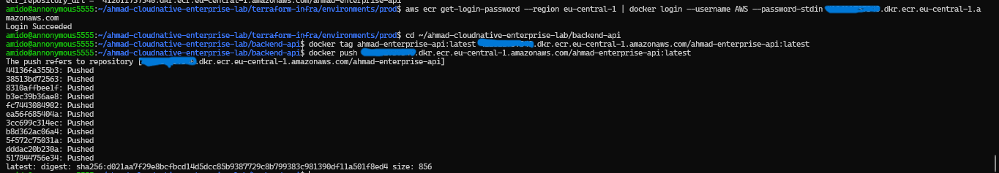

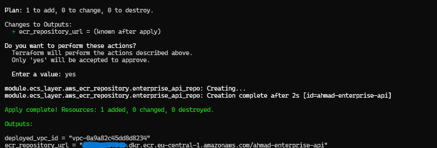

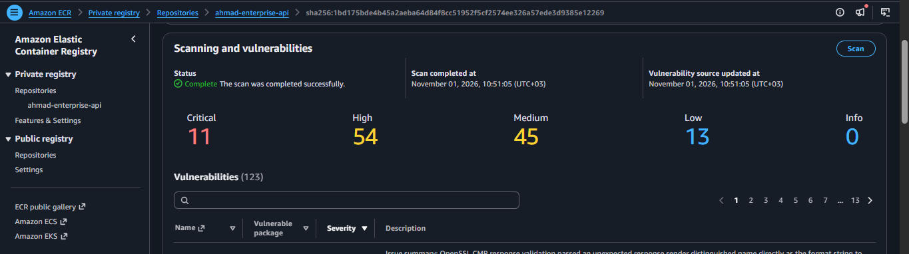

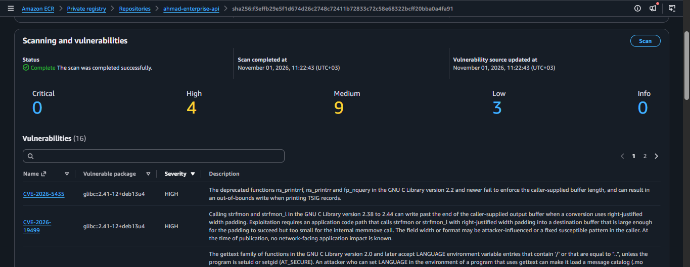

</details>

### 13.4 Runtime, API, and messaging resources

| Evidence | What it demonstrates |
|---|---|
| `aws-ecs-tasks-running.png` | ECS cluster/service and running Fargate tasks |
| `The_working_website.png` | Reachable FastAPI application endpoint |
| `aws-sqs-queues.png` | Main SQS queue and DLQ resources |

<details>
<summary>Show Phase 3–4 screenshots (3)</summary>

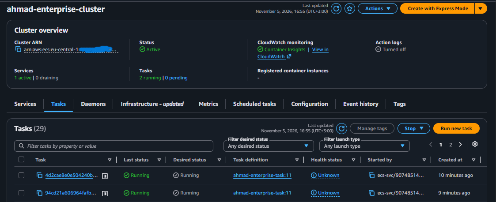

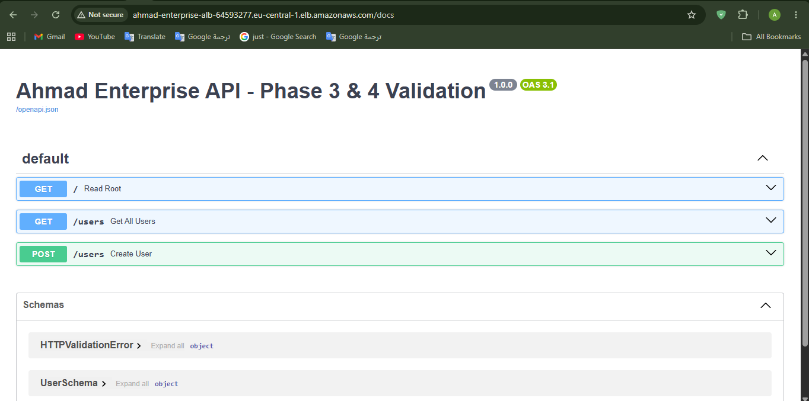

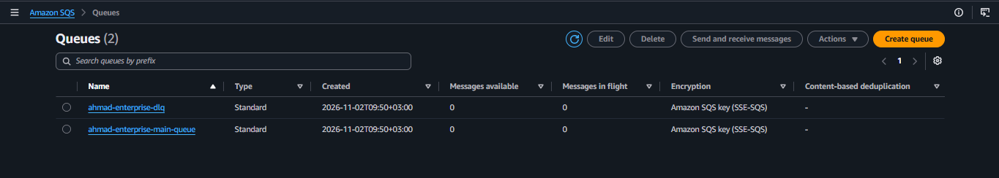

</details>

### 13.5 Encryption, secrets, and edge security

| Evidence | What it demonstrates |
|---|---|
| `Customer_Managed_Key.png` | Customer-managed KMS key |
| `Secrets_Manager.png` | Secrets Manager secret resource |
| `WAF_ACLs.png` | Regional WAF Web ACL |
| `WAF_rules.png` | WAF rule configuration |

<details>
<summary>Show Phase 4–6 screenshots (4)</summary>

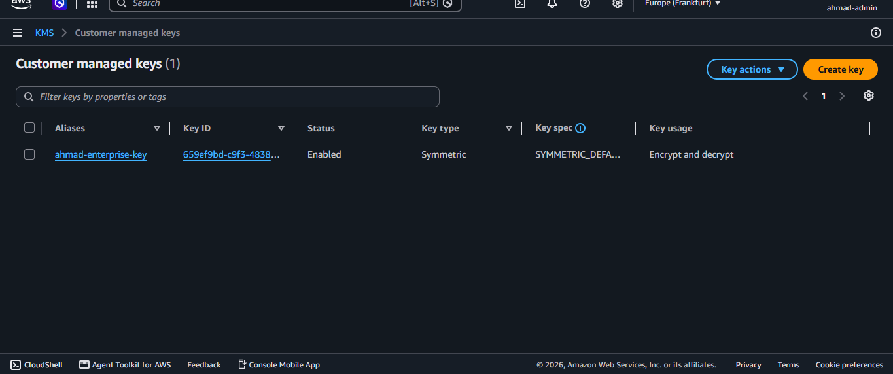

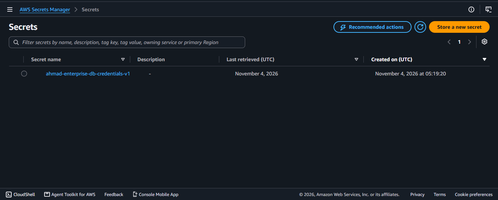

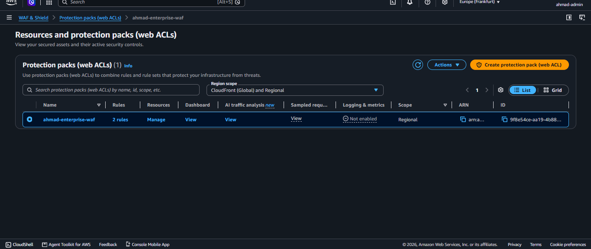

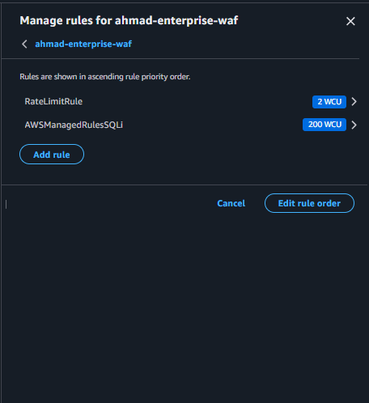

</details>

### 13.6 Resilience and health validation

| Evidence | What it demonstrates |
|---|---|
| `aws-target-group-chaos-healing.jpg` | Target-group health / recovery behavior during a controlled test |

<details>
<summary>Show Phase 8 screenshot (1)</summary>

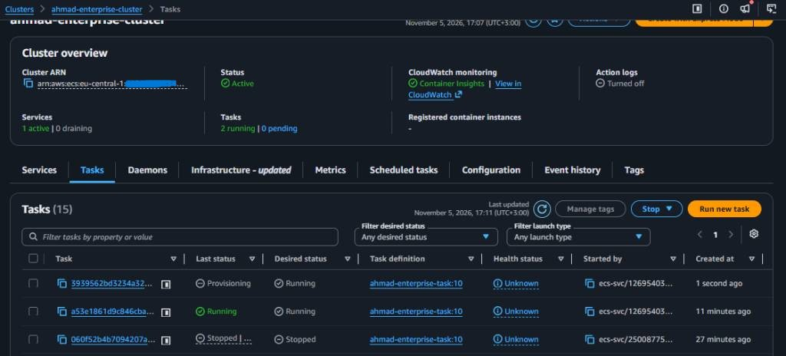

</details>

### 13.7 Observability and alert delivery

| Evidence | What it demonstrates |
|---|---|
| `prometheus_success.png` | Prometheus scrape target status |
| `grafana-live-telemetry-dashboard.png` | Grafana live telemetry view |
| `telegram-alert-notification.png` | Telegram alert delivered by the notification path |

<details>
<summary>Show Phase 5 screenshots (3)</summary>

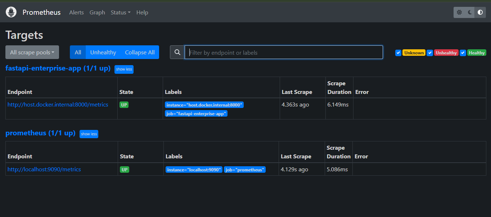

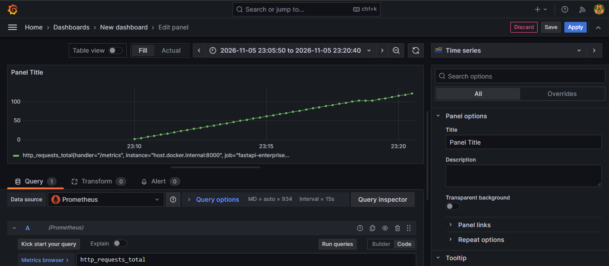

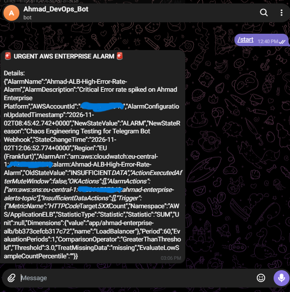

</details>

### 13.8 CI/CD evidence

| Evidence | What it demonstrates |
|---|---|
| `github-actions-success.png` | Successful GitHub Actions workflow run |

<details>
<summary>Show Phase 7 screenshot (1)</summary>

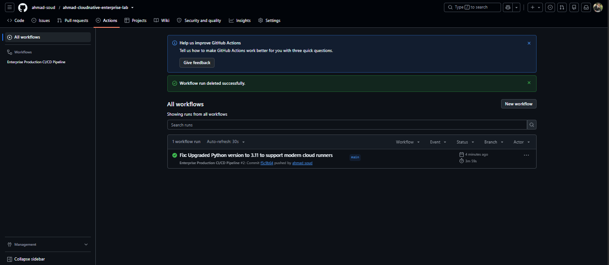

</details>

---

## 14. Engineering Outcomes and Portfolio Talking Points

This project is useful in a technical interview because it provides concrete discussion points across network, cloud, security, and operations engineering:

- **Network segmentation:** explain the public/private/isolated subnet design, per-AZ NAT routing, security-group chaining, and the difference between a subnet group and an actual Multi-AZ database deployment.
- **IaC lifecycle:** explain bootstrap state, state migration, versioning, locking, plan review, module boundaries, and why state must be treated as sensitive data.
- **Container runtime:** explain Fargate `awsvpc` networking, ALB IP targets, task execution role vs task role, target health checks, and immutable image promotion.
- **Asynchronous design:** explain queue buffering, at-least-once delivery, idempotency, visibility timeout, DLQ redrive, and why a provisioned queue does not automatically create a working event-driven system.
- **Security controls:** explain KMS key ownership/rotation, Secrets Manager, IAM least privilege, WAF managed rules, container non-root execution, and the difference between infrastructure and application security.
- **Observability:** explain metrics vs logs, CloudWatch alarms, SNS/Lambda alert routing, Prometheus scrape targets, Grafana visualization, and alert failure modes.
- **Orchestration trade-offs:** compare ECS/Fargate operational simplicity with Kubernetes ecosystem flexibility, HPA control loops, resource requests, pod disruption protection, and cluster add-on responsibilities.
- **Reliability engineering:** show failure injection evidence, explain measured recovery rather than claiming theoretical availability, and describe how to convert experiments into SLOs and runbooks.

### Suggested interview narrative

> “I built a modular Terraform platform in AWS using a three-tier VPC across two Availability Zones. Public ingress terminates at an ALB protected by Regional WAFv2, while the ECS Fargate application runs in private subnets and the PostgreSQL data tier is isolated behind security-group boundaries and KMS encryption. I provisioned SQS with a DLQ, secrets management, ECR image scanning, CloudWatch alarm routing through SNS and Lambda, and a local Prometheus/Grafana telemetry workflow. I also translated the API workload into Kubernetes Deployment, Service, and HPA manifests, including non-root execution, resource quotas, and scale-down stabilization. The repository documents the verified state separately from the remaining production-hardening work, including end-to-end queue integration, HTTPS, RDS Multi-AZ, immutable image releases, and stronger IAM/secret handling.”

---

## 15. References

The following primary documentation is useful for validating the architecture and completing the hardening backlog:

- [Terraform S3 backend — state storage and S3-native lockfile](https://developer.hashicorp.com/terraform/language/backend/s3)
- [Terraform state locking](https://developer.hashicorp.com/terraform/language/state/locking)
- [Amazon ECS IAM role overview](https://docs.aws.amazon.com/AmazonECS/latest/developerguide/ecs-iam-role-overview.html)
- [Amazon ECS task execution role](https://docs.aws.amazon.com/AmazonECS/latest/developerguide/task_execution_IAM_role.html)
- [Amazon RDS Multi-AZ DB instance deployments](https://docs.aws.amazon.com/AmazonRDS/latest/UserGuide/Concepts.MultiAZSingleStandby.html)
- [AWS WAF baseline managed rule groups](https://docs.aws.amazon.com/waf/latest/developerguide/aws-managed-rule-groups-baseline.html)
- [Create an HTTPS listener for an Application Load Balancer](https://docs.aws.amazon.com/elasticloadbalancing/latest/application/create-https-listener.html)
- [Kubernetes Horizontal Pod Autoscaling](https://kubernetes.io/docs/concepts/workloads/autoscaling/horizontal-pod-autoscale/)
- [Python supported versions and end-of-life schedule](https://devguide.python.org/versions/)

---

## 16. Disclaimer

This repository is an educational and portfolio engineering project. Resource availability, service limits, pricing, security requirements, and AWS provider behavior vary by account, Region, and date. Review the generated Terraform plan, account permissions, service documentation, and cost estimates before deployment. Do not use this reference implementation for financial, healthcare, regulated, or other sensitive workloads without a formal threat model, security review, operational ownership, compliance assessment, and validated recovery objectives.
